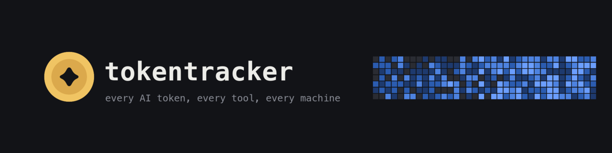

<p align="center">
  <a href="https://tokentracker.patrickbrown.dev"></a>
</p>

<p align="center">
  <a href="LICENSE"></a>
  
  
  
  
  
</p>

<p align="center">
  <a href="https://tokentracker.patrickbrown.dev">Website</a> ·
  <a href="https://tokentracker.patrickbrown.dev/u/bicrick">Live example</a> ·
  <a href="#getting-started">Get started</a> ·
  <a href="#api">API</a> ·
  <a href="#privacy">Privacy</a>
</p>

---

**tokentracker** turns the AI tokens you spend across every coding tool and every computer into one public, queryable API: usage over time, models, tools, a ready-made heatmap, stats and machines, as JSON or CSV.

```sh
curl https://tokentracker.patrickbrown.dev/api/v1/users/bicrick/stats?range=ytd
```

```sh
npx @bicrick/tokentracker init
```

That one command finds the tools on your machine, shows you what it found, creates a `tokentracker-data` repo on **your own GitHub**, saves your history there, and turns on an hourly background sync. Your handle is your GitHub username, and your data is then available at `/api/v1/users/<github-username>`. There is no tokentracker account and no tokentracker database.

## Supported tools

| Tool | How | Read from |
|---|---|---|
| **Claude Code** | local | `~/.claude/projects` (also `~/.config/claude`, `$CLAUDE_CONFIG_DIR`) |
| **Codex** (CLI, IDE extension, app) | local | `~/.codex/sessions`, `archived_sessions` (`$CODEX_HOME`) |
| **OpenCode** (incl. GitHub Copilot, any provider) | local | `~/.local/share/opencode/opencode*.db` |
| **Gemini CLI** | local | `~/.gemini/tmp/*/chats` |
| **Copilot CLI** | local | `~/.copilot/session-state` |
| **DeepSeek Harness** (`dsh`) | local | `~/.dsh/sessions` (`$DSH_HOME`), plain and zstd logs |
| **Cline**, **Roo Code**, **Kilo Code** | local | extension storage in VS Code, Insiders, Cursor, Windsurf, VSCodium, Kiro |
| **Cursor** | server | your public `cursor.com/@handle` profile |

Tools are detected automatically on macOS, Linux and Windows. Planned next: Qwen Code, Factory Droid, Goose, Amp, Zed. See [docs/research/harnesses.md](docs/research/harnesses.md) for formats and paths of every tool we looked at.

## Getting started

Needs **Node 22.13+**.

```sh
npx @bicrick/tokentracker init
```

```
╭──────────────────────────────────────────────────────╮
│  ▪ ▪ ▪ ■ ▪   ✻ Welcome to tokentracker               │
│  ▪ ■ ▪ ▪ ▪   every AI token you spend, every tool,   │
│  ■ ▪ ▪ ■ ▪   every machine, in one place             │
╰──────────────────────────────────────────────────────╯

  ✓ Found 2 tools with usage
    · Claude Code    1.39B tokens · 3,727 responses
    · OpenCode       365M tokens · 1,251 responses

  ✓ Which tools should be tracked? Claude Code, OpenCode
  ✓ Name this machine my-laptop
  ✓ Created you/tokentracker-data · GitHub Pages on
  ✓ Saved 412 day/model rows to you/tokentracker-data
  ✓ Background sync on (launchd, runs hourly and at login, no admin needed)
```

**More computers:** run the same command on each one, signed into the same GitHub. Each computer writes its own files; totals add up.

**GitHub login:** `init` uses the [GitHub CLI](https://cli.github.com) login (`gh auth login`), or a token you paste (scopes `repo`, `workflow`).

### Background sync

`init` installs a per-user hourly job. No admin rights, no permission prompts.

| OS | Mechanism | Logs |
|---|---|---|
| macOS | launchd LaunchAgent (hourly and at login) | `~/Library/Logs/tokentrack.log` |
| Linux | systemd user timer, cron fallback | `~/.local/state/tokentrack/sync.log` |
| Windows | Task Scheduler, per user | `%LOCALAPPDATA%\tokentrack\sync.log` |

Syncs merge into your repo and never delete: Claude Code removes transcripts after about 30 days by default, but days already saved stay saved. If uploads stop, you get a desktop notification, and after 3 quiet days your repo's Action opens an issue (GitHub emails you).

### Commands

| Command | |
|---|---|
| `tokentrack init` | guided setup |
| `tokentrack connect` | choose tools (detected ones are marked *Auto*), add custom folders, connect Cursor |
| `tokentrack sync [--dry]` | save daily totals now. `--dry` prints exactly what is saved |
| `tokentrack status` | repo, machine, last upload, tools and recent syncs |
| `tokentrack install` / `uninstall` | turn background sync on or off |
| `tokentrack build` / `check` | run by your repo's Action: build the static API, flag quiet machines |

Connections live in `~/.config/tokentrack/config.json`:

```json
{
  "connections": {
    "claude-code": { "enabled": "auto" },
    "codex": { "enabled": true, "paths": ["~/work/.codex/sessions"] },
    "cline": { "enabled": false }
  }
}
```

`auto` (the default) means on whenever the tool is found on this machine.

## Privacy

- The collector runs on your machine and saves **only daily token counts per tool and model** to your own repo. Never prompts, code, file paths or API keys.
- `tokentrack sync --dry` prints exactly what is saved:

```json
{ "date": "2026-11-17", "source": "opencode", "model": "github-copilot/claude-opus-5.5",
  "input": 381, "output": 138, "reasoning": 63, "cacheRead": 8448, "cacheWrite": 0, "messages": 1 }
```

- Your data lives in your public `tokentracker-data` repo. To delete everything, delete the repo and run `tokentrack uninstall`.

## API

Public and keyless. All endpoints are `GET`, CORS-enabled and edge-cached. Base URL: `https://tokentracker.patrickbrown.dev/api/v1`. It is stateless: it reads `{handle}.github.io/tokentracker-data/api/v1/rows.json` and computes everything from it.

| Endpoint | Returns |
|---|---|
| `/users/{handle}` | Profile: totals (all time and this year), tools, model and machine counts, first/last day, last sync |
| `/users/{handle}/usage` | Time series: `group=day\|week\|month\|year\|total`, `split=tool\|model` |
| `/users/{handle}/models` | Per-model totals with share, responses, first/last use |
| `/users/{handle}/tools` | Per-tool totals with share and model counts |
| `/users/{handle}/heatmap` | Ready-to-render calendar grid with levels and month labels |
| `/users/{handle}/stats` | Streaks, busiest day, today, this month, top tool and model |
| `/users/{handle}/devices` | Per-machine totals and last sync |

Filters on every endpoint: `range=all|ytd|30d|2026`, `from`/`to`, `tools`, `models`, and `format=csv` on list endpoints.

- Docs with live "try it" consoles: https://tokentracker.patrickbrown.dev/docs
- For LLMs: https://tokentracker.patrickbrown.dev/llms.txt
- OpenAPI 3.1: https://tokentracker.patrickbrown.dev/openapi.json

## Storage and the static API

Your repo is the whole database: `machines/<machine-id>/<year>.json`, one file per computer per year, described in the repo's own `FORMAT.md`. Files carry a format version and every release reads every format, so a repo set up today keeps working for years; the CLI keeps the repo's workflow up to date.

On every change, the repo's Action publishes pre-built JSON to GitHub Pages, so you can use your data with no tokentracker server at all:

```
https://<you>.github.io/tokentracker-data/api/v1/stats.json
https://<you>.github.io/tokentracker-data/api/v1/30d/usage.json      # ranges: ytd, 30d, 90d, 365d
https://<you>.github.io/tokentracker-data/api/v1/heatmap.json
https://<you>.github.io/tokentracker-data/api/v1/rows.json           # every row
```

## Development

```sh
npm install
npm test          # connector, API, storage and heatmap tests
```

## License

MIT. Tool names and logos belong to their owners.
